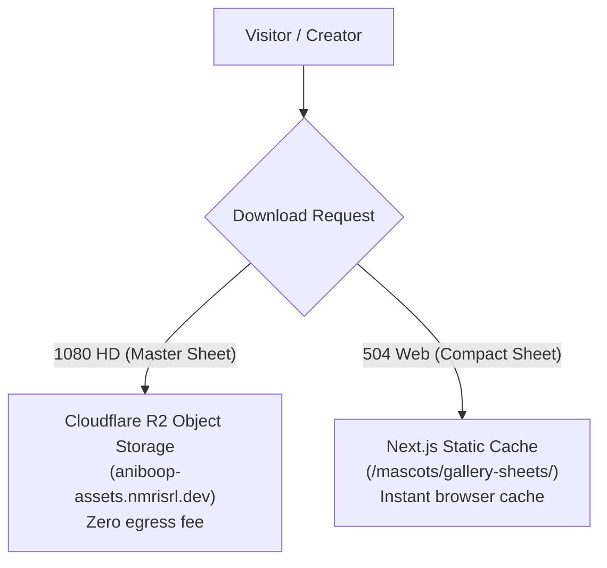

# Cloudflare R2 Storage & Sync Guide

AniBoop serves full-resolution 1080 × 1080 master sprite sheets from Cloudflare R2 object storage to provide high-quality downloads for creators without bloating the Git repository or incurring egress bandwidth costs.

---

## Architecture & Asset Delivery

AniBoop uses a dual-quality delivery pipeline:



| Asset Tier  | Resolution  | Primary Location                                         | Delivery Details                                                                                                                                                     |
| :---------- | :---------- | :------------------------------------------------------- | :------------------------------------------------------------------------------------------------------------------------------------------------------------------- |
| **1080 HD** | 1080 × 1080 | **Cloudflare R2** (`aniboop-assets.nmrisrl.dev/sheets/`) | Full-quality production sheets for design, editing, and archiving. Offloaded to R2 to avoid repository bloat and bandwidth costs (\$0 egress).                       |
| **504 Web** | 504 × 504   | **Next.js App** (`/mascots/gallery-sheets/`)             | Compact playback sheets used directly by the homepage grid for cursor tracking and boop animations. Deployed with the application and cached with immutable headers. |

Implementation references:

- Asset URL resolution: [`src/lib/assets.ts`](../src/lib/assets.ts)
- Download dialog: [`src/components/character/character-details-content.tsx`](../src/components/character/character-details-content.tsx)
- Download handler: [`src/hooks/use-download.ts`](../src/hooks/use-download.ts)

> [!NOTE]
> If `NEXT_PUBLIC_R2_ASSETS_URL` is omitted or offline, 1080 HD downloads automatically fall back to the local compact sheets without error.

---

## Live Cloudflare R2 Configuration

### Bucket Details

- **Bucket Name:** `aniboop-assets`
- **Custom Domain:** `https://aniboop-assets.nmrisrl.dev`
- **Storage Class:** Standard

> [!IMPORTANT]
> **Subdomain Level Constraint (Universal SSL):**
> Cloudflare's free Universal SSL certificate covers only apex domains (`nmrisrl.dev`) and single-level wildcards (`*.nmrisrl.dev`).
>
> - ✅ Single-level subdomains: `aniboop-assets.nmrisrl.dev` or `assets-aniboop.nmrisrl.dev`.
> - ❌ Multi-level subdomains like `assets.aniboop.nmrisrl.dev` (two dots) trigger SSL certificate mismatch warnings unless covered by Cloudflare's paid Advanced Certificate Manager (\$10/month).

### Bucket Folder Hierarchy

Files in R2 must be stored under a top-level `sheets/` prefix to match the URL scheme generated by [`src/lib/assets.ts`](../src/lib/assets.ts):

```text
aniboop-assets (Bucket root)
└── sheets/
    ├── aizawa-directions.webp
    ├── aizawa-reactions.webp
    ├── all-might-directions.webp
    ├── all-might-reactions.webp
    └── ... (278 files for 139 characters)
```

### CORS Policy

In [`src/hooks/use-download.ts`](../src/hooks/use-download.ts), browser downloads use `fetch(url)` &rarr; `response.blob()` to trigger an immediate download with the clean filename (`<id>-directions.webp`).

Without an active CORS policy on R2, cross-origin `fetch()` requests from `http://localhost:3000` or `https://aniboop.nmrisrl.dev` are blocked by browser security and fall back to opening raw images in a new browser tab.

**R2 Bucket CORS Configuration:**

```json
[
	{
		"AllowedOrigins": [
			"http://localhost:3000",
			"https://aniboop.nmrisrl.dev",
			"https://*.nmrisrl.dev"
		],
		"AllowedMethods": ["GET", "HEAD"],
		"AllowedHeaders": ["*"],
		"ExposeHeaders": ["Content-Length", "Content-Type"],
		"MaxAgeSeconds": 3600
	}
]
```

---

## Environment Variables

### Local Development ([`.env.local`](../.env.local))

```env
# Public domain used by the frontend to construct 1080 HD asset download URLs
NEXT_PUBLIC_R2_ASSETS_URL=https://aniboop-assets.nmrisrl.dev

# R2 S3-Compatible API credentials for automated CLI syncing (Git-ignored)
R2_ACCOUNT_ID=c9938330940299c315eccd466af023c1
R2_ACCESS_KEY_ID=your_access_key_id
R2_SECRET_ACCESS_KEY=your_secret_access_key
R2_BUCKET_NAME=aniboop-assets
```

### Production Deployments (Vercel / Cloudflare Pages)

Only the public URL is required in production hosting environments:

- **`NEXT_PUBLIC_R2_ASSETS_URL`**: `https://aniboop-assets.nmrisrl.dev`

_(S3 upload credentials are never needed on production web servers)._

---

## R2 Sync Script (`scripts/sync-r2.py`)

The sync script provides automated upload, verification, and audit tools powered by `boto3`.

### Command Overview

| Command                                      | Purpose                                                                          |
| :------------------------------------------- | :------------------------------------------------------------------------------- |
| `npm run mascot:sync-r2`                     | Batch sync all missing or size-modified sheets in `public/mascots/sheets/` to R2 |
| `npm run mascot:sync-r2 -- --check`          | Audit that all characters in `characters.json` have both master sheets on R2     |
| `npm run mascot:sync-r2 -- --character <id>` | Upload directions and reactions sheets for a single mascot                       |
| `npm run mascot:sync-r2 -- --dry-run`        | Preview what would be uploaded without making any network changes                |
| `npm run mascot:sync-r2 -- --force`          | Re-upload files even if file sizes already match in R2                           |

### Adding a Mascot with Automated R2 Upload

When adding a mascot via [`scripts/add-mascot.py`](../scripts/add-mascot.py), R2 synchronization is **automatic**:

```bash
npm run mascot:add -- --id <id> --name "<Name>" --series "<Series>"
```

1. Validates the 1080 × 1080 source sheets in `public/mascots/raw/`.
2. Generates all 5 WebP assets (`sheets/`, `previews/`, and `gallery-sheets/`).
3. Appends the metadata entry to `src/data/characters.json`.
4. Archives original source sheets to `public/mascots/raw/processed/`.
5. **Calls `scripts/sync-r2.py --character <id>`** to upload the two 1080 sheets directly to Cloudflare R2.
6. If credentials are unset or offline, it gracefully reports that R2 upload was skipped without failing the local addition.

### Updating an Existing Mascot's Artwork

If a character's artwork is revised or updated:

1. Re-optimize the source sheets into `public/mascots/sheets/`.
2. Re-generate previews and playback sheets.
3. Push the revised 1080 sheets to R2:
   ```bash
   npm run mascot:sync-r2 -- --character <id>
   ```

---

## Cloudflare Free Tier & Quota Reference

Cloudflare R2 free tier allowances renew monthly with **\$0 cost**:

- **Storage:** 10 GB / month free (AniBoop uses ~0.049 GB across 139 characters; ~0.5% of quota).
- **Class A Operations (Upload / Write / List):** 1,000,000 requests / month free (Adding 1 character = 2 writes).
- **Class B Operations (Download / Read):** 10,000,000 requests / month free.
- **Egress (Bandwidth):** **\$0.00 unlimited free** (no outbound transfer fees).
- **API Tokens:** Free with unlimited generation.
