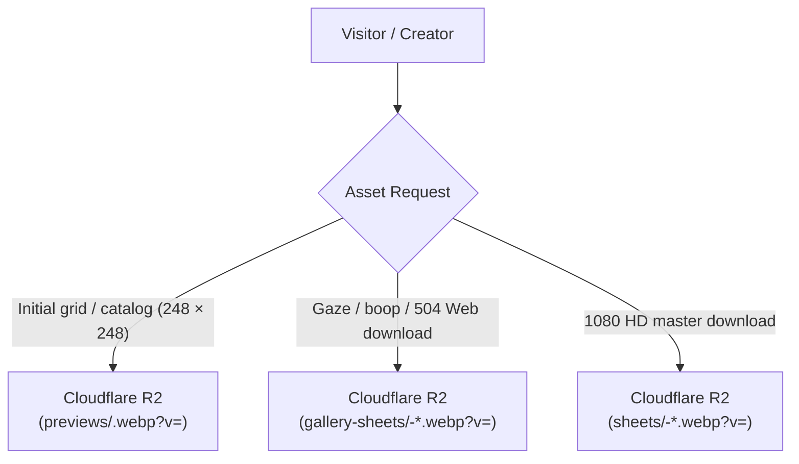

# Cloudflare R2 Storage & Sync Guide

AniBoop serves **all** mascot WebP assets — 248 × 248 center previews, 504 × 504 compact playback sheets, and 1080 × 1080 master download sheets — from Cloudflare R2 object storage to keep the Git repository lean and avoid Vercel bandwidth overages (\$0 egress).

---

## Architecture & Asset Delivery

AniBoop uses a three-tier delivery pipeline hosted on `https://aniboop-assets.nmrisrl.dev`:



| Asset Tier          | Resolution  | R2 Prefix                                                        | Delivery Details                                                                                               |
| :------------------ | :---------- | :--------------------------------------------------------------- | :------------------------------------------------------------------------------------------------------------- |
| **Previews**        | 248 × 248   | `aniboop-assets.nmrisrl.dev/previews/<id>.webp?v=<hash>`         | Center-pose stills rendered in the homepage grid, catalog thumbnails, and README featured lineup.              |
| **504 Web Sheets**  | 504 × 504   | `aniboop-assets.nmrisrl.dev/gallery-sheets/<id>-*.webp?v=<hash>` | Compact 3 × 3 playback sheets used for cursor gaze tracking, boop reactions, and lightweight web downloads.    |
| **1080 HD Masters** | 1080 × 1080 | `aniboop-assets.nmrisrl.dev/sheets/<id>-*.webp?v=<hash>`         | Full-resolution master sheets for design, editing, and archiving, downloaded on demand from Character Details. |

Implementation references:

- Asset URL resolution & `?v=<hash>` versioning: [`src/lib/assets.ts`](../src/lib/assets.ts), [`src/data/characters.ts`](../src/data/characters.ts)
- R2 `<link rel="preconnect">` hint: [`src/app/layout.tsx`](../src/app/layout.tsx)
- Download dialog: [`src/components/character/character-details-content.tsx`](../src/components/character/character-details-content.tsx)
- Download handler: [`src/hooks/use-download.ts`](../src/hooks/use-download.ts)

> [!NOTE]
> If `NEXT_PUBLIC_R2_ASSETS_URL` is unset (e.g., offline local development), asset URLs fall back to local `/mascots/{previews,gallery-sheets}/` paths.

---

## Live Cloudflare R2 Configuration

### Bucket Details

- **Bucket Name:** `aniboop-assets`
- **Custom Domain:** `https://aniboop-assets.nmrisrl.dev`
- **Storage Class:** Standard
- **Caching:** Every object is uploaded with `Cache-Control: public, max-age=31536000, immutable`. Set **Caching → Configuration → Browser Cache TTL** to **Respect Existing Headers** on the Cloudflare zone so Cloudflare preserves the 1-year immutable header instead of overriding it to 4 hours. Each character's 8-character content hash (`v` in `src/data/characters/`) is appended as `?v=<hash>` to bust both CDN and browser caches automatically whenever artwork changes.

> [!IMPORTANT]
> **Subdomain Level Constraint (Universal SSL):**
> Cloudflare's free Universal SSL certificate covers only apex domains (`nmrisrl.dev`) and single-level wildcards (`*.nmrisrl.dev`).
>
> - ✅ Single-level subdomains: `aniboop-assets.nmrisrl.dev` or `assets-aniboop.nmrisrl.dev`.
> - ❌ Multi-level subdomains like `assets.aniboop.nmrisrl.dev` (two dots) trigger SSL certificate mismatch warnings unless covered by Cloudflare's paid Advanced Certificate Manager (\$10/month).

### Bucket Folder Hierarchy

Files in R2 are stored under three top-level prefixes matching [`src/lib/assets.ts`](../src/lib/assets.ts):

```text
aniboop-assets (Bucket root)
├── previews/
│   ├── aizawa.webp
│   └── ... (220 files)
├── gallery-sheets/
│   ├── aizawa-directions.webp
│   ├── aizawa-reactions.webp
│   └── ... (440 files)
└── sheets/
    ├── aizawa-directions.webp
    ├── aizawa-reactions.webp
    └── ... (440 files)
```

### CORS Policy

In [`src/hooks/use-download.ts`](../src/hooks/use-download.ts), browser downloads use `fetch(url)` &rarr; `response.blob()` to trigger an immediate download with the clean filename (`<id>-directions.webp`).

Without an active CORS policy on R2, cross-origin `fetch()` requests from `http://localhost:3000` or `https://aniboop.nmrisrl.dev` are blocked by browser security and fall back to opening raw images in a new browser tab.

**R2 Bucket CORS Configuration:**

```json
[
	{
		"AllowedOrigins": [
			"http://localhost:3000",
			"https://aniboop.nmrisrl.dev",
			"https://*.nmrisrl.dev",
			"https://aniboop.vercel.app"
		],
		"AllowedMethods": ["GET", "HEAD"],
		"AllowedHeaders": ["*"],
		"ExposeHeaders": ["Content-Length", "Content-Type"],
		"MaxAgeSeconds": 3600
	}
]
```

---

## Environment Variables

### Local Development ([`.env.local`](../.env.local))

```env
# Public domain used by the frontend to construct all mascot asset URLs
NEXT_PUBLIC_R2_ASSETS_URL=https://aniboop-assets.nmrisrl.dev

# R2 S3-Compatible API credentials for automated CLI syncing (Git-ignored, local only)
R2_ACCOUNT_ID=your_cloudflare_account_id
R2_ACCESS_KEY_ID=your_access_key_id
R2_SECRET_ACCESS_KEY=your_secret_access_key
R2_BUCKET_NAME=aniboop-assets
```

### Production & Preview Deployments (Vercel / Cloudflare Pages)

Only the public URL is required on Vercel — set it for **both Production and Preview** (since local `previews/` and `gallery-sheets/` are Git-ignored):

- **`NEXT_PUBLIC_R2_ASSETS_URL`**: `https://aniboop-assets.nmrisrl.dev`

_(S3 upload credentials `R2_ACCOUNT_ID`, `R2_ACCESS_KEY_ID`, `R2_SECRET_ACCESS_KEY`, and `R2_BUCKET_NAME` stay strictly local in `.env.local` and should never be added to Vercel.)_

---

## R2 Sync Script (`scripts/sync-r2.py`)

The sync script provides automated upload, verification, and audit tools powered by `boto3`.

### Command Overview

| Command                                      | Purpose                                                                                             |
| :------------------------------------------- | :-------------------------------------------------------------------------------------------------- |
| `npm run mascot:sync-r2`                     | Parallel-sync all missing or size-modified WebPs (`previews/`, `gallery-sheets/`, `sheets/`) to R2  |
| `npm run mascot:sync-r2 -- --check`          | Audit that every character in `src/data/characters/` has all 5 assets present on R2                 |
| `npm run mascot:sync-r2 -- --verify-cdn`     | Fetch public `?v=<hash>` CDN URLs and verify their bytes match local WebPs (supports `--character`) |
| `npm run mascot:sync-r2 -- --character <id>` | Upload all 5 WebPs (`previews/`, `gallery-sheets/`, `sheets/`) for a single mascot                  |
| `npm run mascot:sync-r2 -- --tier previews`  | Limit sync or audit to a single tier (`previews`, `gallery-sheets`, `sheets`, or `all`)             |
| `npm run mascot:sync-r2 -- --sync-versions`  | Recompute and write 8-character SHA-256 revision hashes (`v`) into `src/data/characters/`           |
| `npm run mascot:sync-r2 -- --dry-run`        | Preview what would be uploaded without making any network changes                                   |
| `npm run mascot:sync-r2 -- --force`          | Re-upload files even if file sizes already match in R2 (useful to refresh object headers)           |

### Adding a Mascot with Automated R2 Upload

When adding a mascot via [`scripts/add-mascot.py`](../scripts/add-mascot.py), R2 synchronization is **automatic**:

```bash
npm run mascot:add -- --id <id> --name "<Name>" --series "<Series>"
```

1. Validates the 1080 × 1080 source sheets in `public/mascots/raw/`.
2. Generates all 5 WebP assets (`sheets/`, `previews/`, and `gallery-sheets/`) in a staging directory and computes the 8-char SHA-256 content hash (`v`).
3. **Uploads all 5 staged WebPs to Cloudflare R2 first** (`scripts/sync-r2.py --character <id> --assets-dir <staging> --skip-if-unconfigured`) with `Cache-Control: public, max-age=31536000, immutable` — before touching `src/data/characters/` so open dev tabs never request an un-uploaded `?v=<hash>` URL.
4. Commits the local WebPs, appends `{ id, name, v }` to the character's series file under `src/data/characters/` (registering new series in `src/data/characters/index.ts`), and archives original source sheets to `public/mascots/raw/processed/`.
5. If R2 credentials are unset, it gracefully skips R2 upload with a warning; if credentials are set and upload fails, it aborts before mutating the catalog.

### Updating an Existing Mascot's Artwork

Use [`scripts/update-mascot.py`](../scripts/update-mascot.py) when replacing an existing character's source pair in `public/mascots/raw/`:

```bash
npm run mascot:update -- --id <id>
```

1. Re-optimizes the 1080 sheets and regenerates previews and compact playback sheets in a staging directory, then computes the new `v` hash.
2. **Uploads all 5 updated WebPs to Cloudflare R2 first** — before updating `src/data/characters/` — so Cloudflare can never cache the previous artwork under the new immutable `?v=<hash>` URL.
3. Backs up any existing local WebPs to `public/old-version/mascots/`, moves the regenerated WebPs into place, updates `v` in the character's series file under `src/data/characters/`, and archives the source pair.

> [!NOTE]
> Avoid using `--skip-r2` while `next dev` is open against live R2 (sync to R2 before loading the page). If you update a character featured in [`README.md`](../README.md), include `?v=<new_hash>` on its preview image URL so Cloudflare and GitHub's image proxy fetch the updated artwork.

---

## Cloudflare Free Tier & Quota Reference

Cloudflare R2 free tier allowances renew monthly with **\$0 cost**:

- **Storage:** 10 GB / month free (AniBoop’s 1100 catalog WebPs for 220 characters total about 0.104 GB, or 1.04% of the quota).
- **Class A Operations (Upload / Write / List):** 1,000,000 requests / month free (Adding or updating 1 character = 5 writes).
- **Class B Operations (Download / Read):** 10,000,000 requests / month free (dramatically reduced by Cloudflare edge caching).
- **Egress (Bandwidth):** **\$0.00 unlimited free** (no outbound transfer fees).
- **API Tokens:** Free with unlimited generation.
